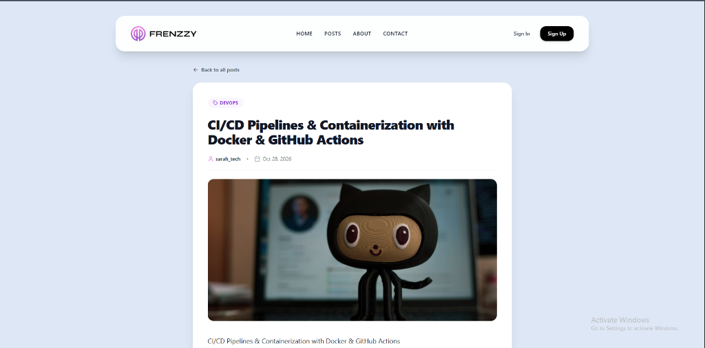
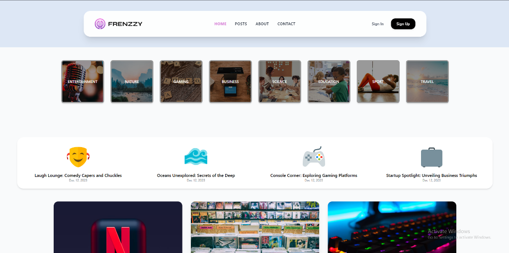
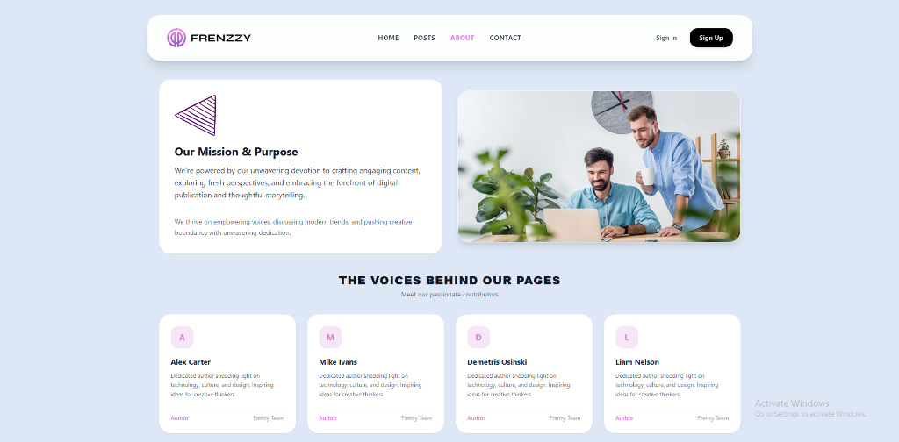

# 🚀 Frenzy Blog — Modern Fullstack Publishing Platform

[](https://react.dev/)
[](https://vitejs.dev/)
[](https://nodejs.org/)
[](https://expressjs.com/)
[](https://www.mongodb.com/atlas)
[](https://tailwindcss.com/)

**Frenzy Blog** is a production-ready, full-stack tech blogging and publishing platform. It features a reactive, modern Single-Page Application (SPA) frontend and a layered RESTful API backend with **MongoDB Atlas**, comprehensive **Markdown rendering**, category-based browsing, JWT authentication, and a built-in automated **Data Seeding & Exporter System**.

---

## 📸 Platform Previews

### 1. Rich Technical Article & Markdown Reader
> Full support for GitHub-flavored Markdown (GFM), syntax code highlighting, custom typography, and responsive media.



---

### 2. Home & Category Discovery
> Explore curated articles filtered by tech domains: Frontend, Backend, Database, DevOps, and Fullstack.



---

### 3. About & Editorial Community
> Mission, purpose, and passionate contributors showcase.



---

## ✨ Key Features

- **Full Markdown Engine:** Articles support GitHub-Flavored Markdown (GFM) including headers, code blocks with dark theme formatting, blockquotes, lists, tables, and images.
- **RESTful API Backend:** Clean architecture with modular separation of concerns (Controllers, Models, Routes, Middlewares).
- **Secure Authentication:** User registration & login with password hashing (`bcryptjs`) and stateless `JSON Web Tokens (JWT)`.
- **My Articles Management:** Dedicated author dashboard (`/my-posts`) for creating, editing, and deleting published posts.
- **Category Filtering:** Filter posts seamlessly across `frontend`, `backend`, `fullstack`, `devops`, `database`, and `other`.
- **Automated Seeding System (`npm run seed`):** Re-populate a clean database with 10 in-depth tech articles and test accounts in seconds.
- **Portable Data Exporter (`npm run export:data`):** Export live database articles and authors directly to version-controlled JSON for easy backup and migration.
- **Clean Responsive UI:** Built with TailwindCSS, Lucide Icons, and React Router 7.

---

## 🛠️ Tech Stack

### Frontend (Client)
- **Framework:** React 19 + Vite 5
- **Routing:** React Router DOM (v7)
- **State & Form Management:** Formik + Yup, Redux Toolkit
- **Styling:** Tailwind CSS + Custom Markdown Typography
- **Markdown Parser:** `marked` (GFM compliant)
- **Icons:** Lucide React & Heroicons

### Backend (Server)
- **Runtime:** Node.js (v20+) with ES Modules (`"type": "module"`)
- **Framework:** Express.js 4.x
- **Database:** MongoDB Atlas with Mongoose ORM
- **Authentication:** JWT (JSON Web Tokens) & bcryptjs
- **File Uploads:** Multer + Cloudinary SDK
- **Validation:** Express-Validator

---

## 📂 Project Structure

```text
frenzy-blog/
├── client/                     # Frontend Application (React 19 + Vite)
│   ├── public/                 # Static assets
│   ├── src/
│   │   ├── components/         # Reusable UI & Layout components
│   │   ├── pages/              # Views (Home, Posts, ArticleDetails, MyPosts, etc.)
│   │   ├── routes/             # App routing configuration
│   │   └── services/           # Axios API services & interceptors
│   ├── index.html
│   ├── tailwind.config.js
│   ├── vite.config.js
│   └── package.json
│
├── server/                     # Backend API (Node.js + Express + MongoDB)
│   ├── src/
│   │   ├── config/             # Database connection & Cloudinary setup
│   │   ├── controllers/        # Request handling logic (posts, users)
│   │   ├── data/               # Seed data & JSON backup files
│   │   ├── middleware/         # Auth verification & file upload middlewares
│   │   ├── models/             # Mongoose schemas (Post, User)
│   │   ├── routes/             # API route definitions
│   │   └── scripts/            # Database seeder and data export scripts
│   ├── index.js                # Server entry point
│   ├── vercel.json             # Vercel deployment configuration
│   └── package.json
│
├── docs/                       # Project documentation & screenshots
│   └── screenshots/
└── README.md                   # Master Documentation
```

---

## 🚀 Getting Started

### Prerequisites
- **Node.js** (v18.0.0 or higher)
- **npm** (v9.0.0 or higher)
- **MongoDB** connection string (Local or MongoDB Atlas)

---

### 1. Clone the Repository

```bash
git clone https://github.com/dev-ahmed-ragab/frenzy-blog.git
cd frenzy-blog
```

---

### 2. Server Setup

Navigate to the `server` directory and install dependencies:

```bash
cd server
npm install
```

Create a `.env` file inside `server/` (see `server/.env.example`):

```env
PORT=5000
MONGODB_URI=your_mongodb_atlas_connection_string
JWT_SECRET=your_jwt_secret_key_here
JWT_EXPIRE=7d
```

#### Seed Initial Articles & Users
To populate your database with 10 full technical articles and test users:

```bash
npm run seed
```

#### Start the Server

```bash
npm run dev   # Starts with nodemon for development
# or
npm start     # Starts production server
```

The API will be available at: **`http://localhost:5000`**

---

### 3. Client Setup

Open a new terminal window, navigate to the `client` directory and install dependencies:

```bash
cd client
npm install
```

Create a `.env` file inside `client/` (optional, defaults to `http://localhost:5000`):

```env
VITE_API_URL=http://localhost:5000
```

Start the Vite development server:

```bash
npm run dev
```

Open your browser and navigate to: **`http://localhost:5173`**

---

## 🔑 Test Credentials

Use these pre-seeded accounts to explore publishing and author features:

| Email | Password | Role / Username |
| :--- | :--- | :--- |
| `ahmed@frenzy.dev` | `Password123!` | Author (`ahmed_dev`) |
| `sarah@frenzy.dev` | `Password123!` | Author (`sarah_tech`) |

---

## 📡 Core API Endpoints

### Authentication & Users
- `POST /api/users/register` — Register a new account
- `POST /api/users/login` — Login & receive JWT token
- `GET /api/users/profile` — Get authenticated user profile
- `PUT /api/users/:id` — Update profile & avatar

### Articles & Posts
- `GET /api/posts` — Retrieve all posts (supports sorting & population)
- `GET /api/posts/:id` — Retrieve single post by ID
- `GET /api/posts/user` — Retrieve authenticated user's posts *(Protected)*
- `POST /api/posts` — Create a new article *(Protected + Image upload)*
- `PUT /api/posts/:id` — Update an existing article *(Protected)*
- `DELETE /api/posts/:id` — Delete an article *(Protected)*

---

## 💾 Data Backup & Seeding Scripts

- **`npm run seed`** (in `server/`): Connects to the configured MongoDB cluster and seeds 10 articles and test users.
- **`npm run export:data`** (in `server/`): Dumps current database articles and user profiles into `server/src/data/backup.json` to keep data versioned in Git.

---

## 📄 License

This project is open-source and available under the [ISC License](LICENSE).

